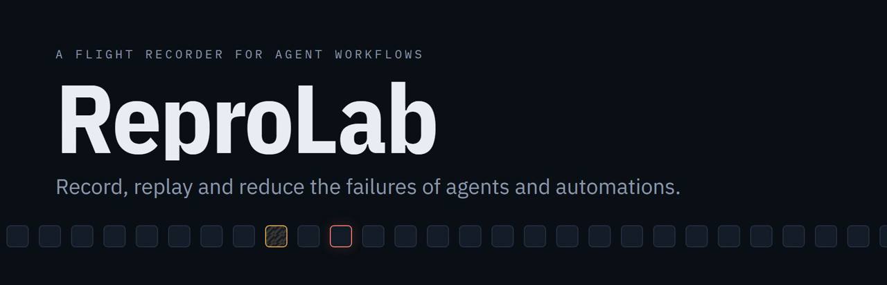
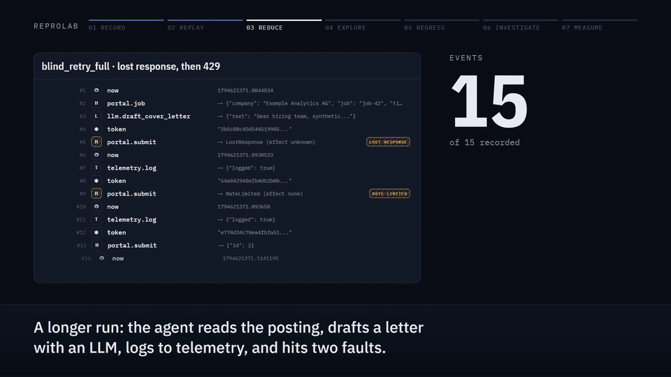
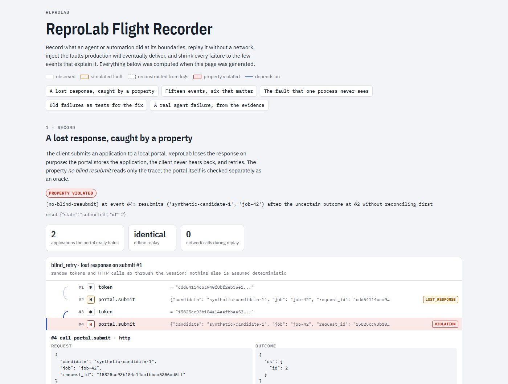
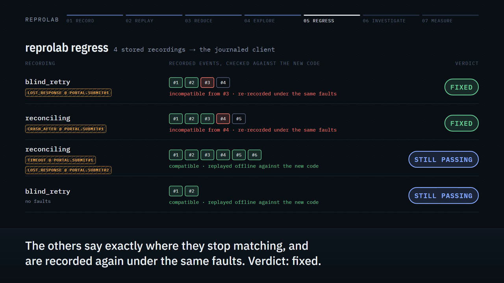
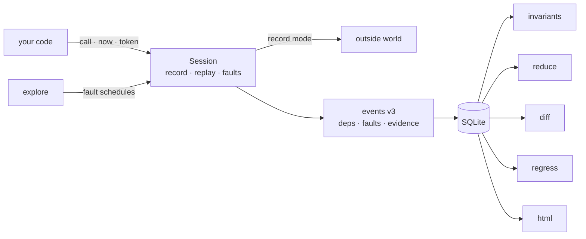

<p align="center">
  
</p>

<p align="center">
  <a href="https://github.com/Andros5/reprolab/actions/workflows/ci.yml"></a>
  <a href="https://github.com/Andros5/reprolab/releases/latest"></a>
  
  
  <a href="https://github.com/astral-sh/ruff"></a>
  <a href="LICENSE"></a>
</p>

<p align="center">
  <b>Record, replay and reduce the failures of agents and automations,<br>and keep each one as a regression test for a business property.</b>
</p>

<p align="center">
  <a href="#quickstart">Quickstart</a> ·
  <a href="#real-failures-it-has-explained">Case studies</a> ·
  <a href="docs/README.md">Documentation</a> ·
  <a href="https://github.com/Andros5/reprolab/releases/download/v1.0.0/reprolab-demo.mp4">Demo video (101 s)</a> ·
  <a href="CHANGELOG.md">Changelog</a>
</p>

---

An agent submits a job application. The portal stores it, but the response is lost on the way back. The agent retries, and now there are two applications. In production, a failure like this is rare, and it seldom happens again when someone looks for it. **ReproLab makes it happen on purpose, records it, replays it offline, shrinks it to the few events that explain it, and turns it into a test that fails until the code is fixed.**

<p align="center">
  
  <br><sub>Delta debugging keeps the same property violated at the same event, and never drops an event that a kept one depends on.</sub>
</p>

## Why ReproLab

Agents and automations fail at their **boundaries**: an HTTP call whose answer never arrives, a rate limit, a model that answers the same request differently, a worker that dies right after a write. These failures are rare, hard to reproduce and easy to misdiagnose. ReproLab instruments exactly those boundaries and nothing else, so it works on real code with a few lines of change.

| | What you get |
|---|---|
| 🎥 **Record** | Every external call, clock reading and random token, with its outcome and what the caller can know about side effects (`effect: none \| unknown`). |
| ⏪ **Replay offline** | The same code runs against the recording with the network disabled: same trace, same verdict. |
| 💥 **Inject faults** | Lost response, 429, timeout, duplicate delivery, invalid output, crash after the call took effect. Every injected fault is marked `simulated`. |
| ✂️ **Reduce** | Dependency-aware delta debugging down to a 1-minimal trace that still violates the same property at the same event. |
| 🧭 **Explore** | Seeded, coverage-guided search over fault schedules. Same seed, same findings. Counterexamples are minimised by re-execution. |
| 🔁 **Regress** | Stored failures replay against new code; the ones that no longer match say at which event, and are re-recorded under the same faults. |
| 🔍 **Diff and view** | First divergence between two runs, and self-contained HTML reports in a flight-recorder style. |
| 📜 **Evidence** | Runs rebuilt from another system's logs cite a file, a JSON pointer and a SHA-256 for every event. |

All of it uses the Python standard library and SQLite. There are no runtime dependencies and no external services.

## Quickstart

```bash
git clone https://github.com/Andros5/reprolab.git && cd reprolab
python -m venv .venv
.venv/Scripts/python -m pip install -e ".[dev]"     # .venv/bin/python on Linux and macOS
python -m examples.quickstart
```

[`examples/quickstart.py`](examples/quickstart.py) pays an invoice through an external service and loses the first response on purpose:

```text
naive        result {'charge_id': 2}  real charges 2
             [charge-at-most-once] at event #2: charges again after #1 without checking
             offline replay: identical, 1 violation(s)

reconciling  result {'state': 'already charged'}  real charges 1
             offline replay: identical, 0 violation(s)
```

The reconciling version survives that fault. Let the explorer look for the faults it does not survive:

```bash
reprolab explore examples.quickstart:reconciling --budget 50
```

```text
[property] charge-at-most-once at bank.charge
   minimal schedule (1 -> 1 faults, 1 re-executions): bank.charge:1:crash_after
[unhandled] KeyError after bank.find
   minimal schedule (2 -> 2 faults, 2 re-executions): bank.charge:1:lost_response, bank.find:1:invalid_output
[oracle-only] 2 charges for one invoice
   minimal schedule (1 -> 1 faults, 1 re-executions): bank.charge:1:duplicate
Only the schedules above were tried: a finding is a reproducible counterexample,
but no finding does not show the system is correct.
```

It finds three problems in 50 runs. A crash right after the charge makes the restarted worker forget it and charge again. A malformed lookup is not handled. A duplicate delivery charges twice without anything on the trace to show it, so only the real state (the oracle) reveals it. Each finding is stored as a run you can replay, view and keep as a regression test.

## Use it on your code

Three steps. Route the boundary through the session, state the property on the trace, and wrap both in a `Scenario`:

```python
from reprolab import BoundaryError, Scenario, Violation

def pay(session, bank):
    try:
        return session.call("bank.charge", INVOICE, bank.charge)   # recorded, replayable, faultable
    except BoundaryError as error:
        ...                                                         # error.effect says what the caller can know

def charge_at_most_once(events) -> list[Violation]:
    ...                                                             # reads the trace only

pay_invoice = Scenario(name="pay", run=pay, invariants=(charge_at_most_once,),
                       live=start_real_or_local_service, offline=Unreachable)
```

```bash
reprolab record   my_module:pay_invoice --fault bank.charge:1:lost_response
reprolab replay   <run>                    # offline; exit 1 on divergence
reprolab reduce   <run>                    # shrink to the events the violation needs
reprolab explore  my_module:pay_invoice    # exit 1 if a business property can be violated
reprolab regress  --target my_module:pay_invoice_v2
reprolab html     <run> --compare <other-run>
```

There is a [step-by-step guide](docs/getting-started.md) and a [full CLI reference](docs/cli.md).

<p align="center">
  
  <br><sub><code>reprolab html</code> and <code>python -m examples.showcase</code> write self-contained pages like this one. Hatched marks are simulated faults; arcs are dependencies.</sub>
</p>

## Real failures it has explained

### 🗓️ CitaLab: a reschedule that created a second appointment

[CitaLab](https://github.com/Andros5/citalab) is a public, conversational assistant for synthetic healthcare appointments, evaluated in a master's thesis. In 9 of 12 episodes, a request to move an appointment created a new one, although every safety check passed. [The investigation](docs/investigations/citalab-r02.md) rebuilds those episodes from the logs with cited evidence:

- The property *a reschedule must replace its target* agrees with CitaLab's own oracle in **12 of 12** episodes.
- The model received a **byte-identical** request in 4 episodes. It answered "reschedule" once and "book" three times, and `reprolab diff` shows that the runs are identical up to that answer.
- Re-executing CitaLab's evaluated code against the recorded answers reproduces **12 of 12** episodes.
- Each failure reduces to its causal chain: interpretation `book` → proposal → confirmation → write.

### 📮 Swiss Job Radar: a real submission path, unchanged

ReproLab was put around the radar's real `send()` [without changing a single radar line](docs/investigations/radar-submit.md). It took a 220-line adapter, and the radar's 366 tests still pass. There was no second click under any of 240 schedules of up to two faults per restart model. One finding remains: a crash after the click leaves the state `sending`, which reconciliation refuses until the web server restarts.

### 🧪 The portal demo: seeded defects, measured

```bash
python -m examples.portal_demo      # record, replay offline, reduce
python -m examples.showcase         # every case, run live, on one HTML page
```

Five client variants with known defects were each explored with a budget of 200 and seeds 0–2 ([metrics](docs/metrics.md)). The explorer found a defect in **21 of 21** explorations of a defective variant, with **0 false alarms** in 9 explorations of a correct one, and identical findings per seed. Each counterexample reduces to 4 events. Recording a boundary call costs about 14 µs.

<p align="center">
  
</p>

## Limits, stated up front

- **Replay reuses recorded outcomes.** It does not show that a model or a service would answer the same way again.
- **Injected faults are simulations**, marked `fault.simulated: true` in every event. A crash is modelled only at a boundary, after the call took effect.
- **A clean exploration is not a proof of correctness.** The explorer covers the schedules it reports, and says how much of the space that was.
- **Determinism covers instrumented boundaries only.** Threads, the OS and uninstrumented I/O are out of scope.
- **A reduced trace is 1-minimal, not a global minimum**, and it is a regression fixture, not an execution.
- **A reconstructed run is only as good as the logs it comes from**, and every derived event names the rule that produced it.

The [complete list](docs/limits.md) has the rest.

## How it works



The `Session` is the only door to the outside. In record mode the real call runs, with an optional injected fault, and its outcome becomes an event. In replay mode nothing external runs: each call must match the next event, or a `ReplayDivergence` says how it differs. Invariants read only the trace, so the original run and every replay get the same verdict. The [architecture](docs/architecture.md), [concepts](docs/concepts.md) and [design decisions](docs/design-decisions.md) cover the rest.

## Documentation

| Guide | Reference | Background |
|---|---|---|
| [Getting started](docs/getting-started.md) | [CLI](docs/cli.md) | [Architecture](docs/architecture.md) |
| [Concepts](docs/concepts.md) | [Event schema v3](docs/schema.md) | [Design decisions](docs/design-decisions.md) |
| [The explorer](docs/explorer.md) | [Limits](docs/limits.md) | [Measured results](docs/metrics.md) |
| [Regression and reports](docs/regress.md) | [Changelog](CHANGELOG.md) | [Investigations](docs/investigations/) |

## Project status

Version 1.0.0 is stable. Its five milestones are done: capture and offline replay, a versioned schema with reduction, a real investigation, the explorer, and differential replay. The event schema is versioned, and older recordings are migrated on read. The [changelog](CHANGELOG.md) lists what changed, and the [roadmap](docs/roadmap.md) lists what may come next.

## Contributing

Issues and pull requests are welcome. Please read [CONTRIBUTING.md](CONTRIBUTING.md), which covers the development setup, the checks CI runs and the project's standards for claims and evidence. Security issues go through [SECURITY.md](SECURITY.md).

## Citing

If ReproLab helps your work, GitHub's **Cite this repository** button uses [CITATION.cff](CITATION.cff).

## Licence

The code is under the [MIT licence](LICENSE). The CitaLab evidence in `examples/citalab_r02/data/` is synthetic data under CC BY 4.0, copied verbatim with attribution. The demo video's music is “Ethereal” by Amarent, under CC BY 4.0 (see [video/README.md](video/README.md)).
