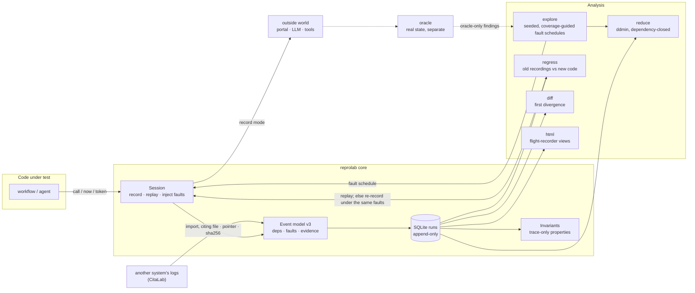

# Architecture

ReproLab sits at the boundaries of a workflow: every call that leaves the process (HTTP, an LLM, a tool), every clock reading and every random token goes through a `Session`. Everything else is built on the events that the `Session` records.

## The pieces

| Module | Role |
|---|---|
| `session.py` | The only door to the outside. Records outcomes or serves them back; injects simulated faults; restarts the code after a simulated crash. |
| `events.py` | The event model and its strict validation, value-based dependency inference, migrations from v1 and v2. |
| `store.py` | Append-only runs in SQLite and portable JSON documents; origins `recorded`, `reduced`, `reconstructed`. |
| `invariants.py` | Business properties as functions of the trace alone. |
| `reduce.py` | Delta debugging over events, closed under dependencies, anchored to the same violation. |
| `explore.py` | Bounded, seeded exploration of fault schedules; counterexamples reduced by re-execution. |
| `regress.py` | Differential replay of stored recordings against new code. |
| `diff.py` | First divergence between two traces, optionally ignoring random and clock values. |
| `html.py` | Self-contained visual reports. |
| `cli.py` | `record · replay · show · list · reduce · diff · explore · regress · html · export`. |

## Data flow of one failure, end to end

1. **Explore.** `explore` runs the scenario under a fault schedule against the local portal.
2. **Find.** The trace violates *no blind resubmit*.
3. **Shrink the schedule.** The explorer re-executes with fewer faults until a single `crash_after` remains.
4. **Shrink the trace.** `reduce` keeps the 4 events the violation needs.
5. **Store.** Both runs go to SQLite. Either can be replayed offline, viewed with `html` or exported as JSON.
6. **Regress.** When the client is fixed, `regress` replays the stored recording against it: it is incompatible from event #4, so it is re-recorded under the same fault plan and the verdict is **fixed**.
