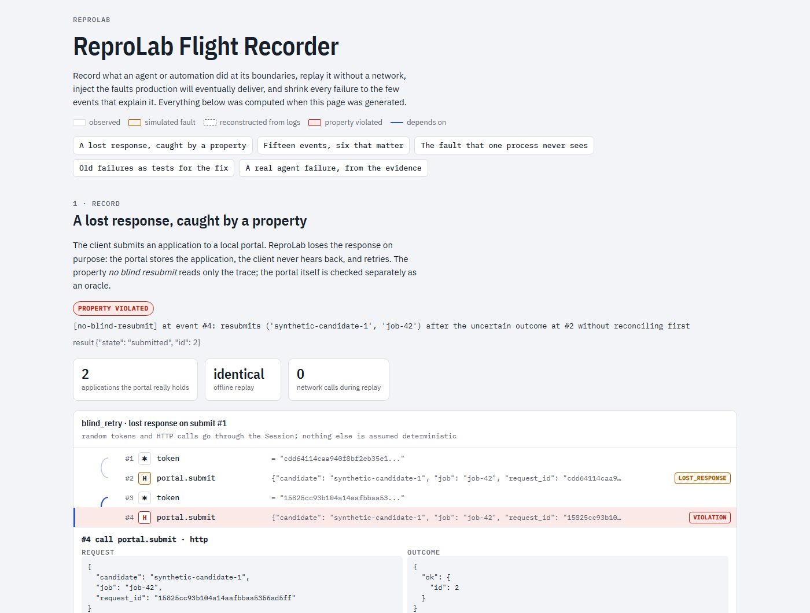

# Regression and reports

## Old failures as tests for new code

```bash
reprolab regress --target examples.portal_demo.scenario:journaled
```

`regress` replays every stored recording against a new version of the code. A recording falls into one of two cases:

- **Compatible.** The new code still matches the recording. It replays offline and gives its verdict.
- **Incompatible.** The new code no longer matches the recording. It is marked *incompatible from event #k*, with the reason, and is then recorded again under the same fault plan against the local environment.

Each recording then gets a verdict:

| Verdict | Before | After |
|---|---|---|
| **fixed** | violated | holds |
| **still failing** | violated | violated |
| **regressed** | held | violated |
| **still passing** | held | holds |

The command exits with 1 while anything still fails, so the library of past incidents can gate a build.

| Option | Meaning |
|---|---|
| `--target` | The new code, as `module:attribute` (required). |
| `--from` | Only recordings of this target. The default is all recorded runs. |
| `--runs` | Comma-separated run ids or prefixes. |
| `--no-rerecord` | Reports incompatible recordings without recording them again. |
| `--report` | Writes the results as JSON. |

`regress` re-applies a recording's faults by call name and occurrence. If the new code calls differently, a planned fault can land on a different step or not fire at all, so the report lists both the faults planned and the faults that fired.

When it compares old and new traces, random tokens and clock readings are matched by order of appearance. The first difference it reports is therefore a change in behaviour, not a new random id.

## Visual reports

```bash
reprolab html <run>                                    # one run
reprolab html <run> --compare <other> --ignore-nondeterminism   # two runs, from the first divergence
python -m examples.showcase                            # every case, run live, on one page
```

`html` writes a self-contained page in a flight-recorder style:

- solid marks are observed events;
- diagonal hatching marks a simulated fault;
- a dashed outline marks an event reconstructed from logs;
- arcs in the margin are dependencies;
- clicking an event shows its request, its outcome and its evidence.

A comparison shows two runs side by side from their first divergence. A reduction shows the dropped events faded. The pages need no network and no dependencies.


